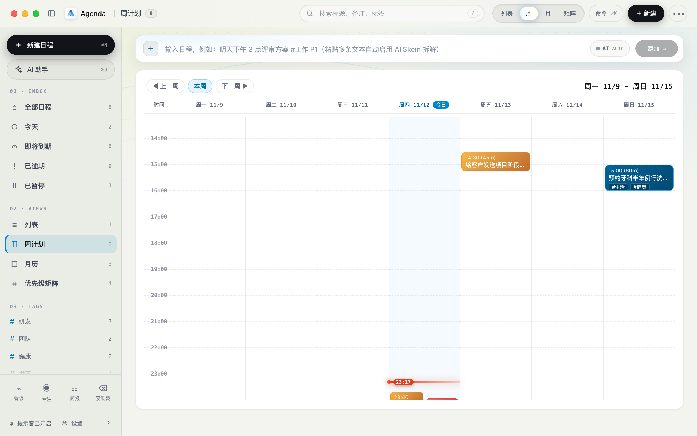
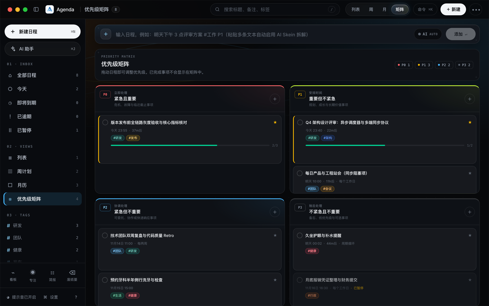

<div align="center">



# Agenda Butler · 日程管家

**基于 Wails 3 + Vue 3 + Golang + SQLite 构建的现代化极速 AI 桌面日程管理应用**

[](https://github.com/sayhia/agenda/actions/workflows/ci.yml)
[](https://github.com/sayhia/agenda/releases/latest)
[](https://go.dev/)
[](https://vuejs.org/)
[](./LICENSE)
[]()

[📥 下载最新版本](https://github.com/sayhia/agenda/releases/latest) · [✨ 核心特性](#-核心特性) · [📸 界面预览](#-界面预览) · [⌨️ 快捷键](#️-全局快捷键) · [🚀 开发与编译](#-本地开发与编译)

<br/>


</div>

---

## 📥 跨平台下载安装 (Downloads)

前往 [GitHub Releases](https://github.com/sayhia/agenda/releases/latest) 直接获取最新安装包：

| 操作系统 | 下载文件 | 架构支持 / 说明 |
| :--- | :--- | :--- |
| **macOS (Apple Silicon)** | [`.dmg`](https://github.com/sayhia/agenda/releases/latest) / [`.app.tar.gz`](https://github.com/sayhia/agenda/releases/latest) | 适配 M1 / M2 / M3 / M4 等 Apple Silicon 芯片 (`arm64`) |
| **macOS (Intel)** | [`.dmg`](https://github.com/sayhia/agenda/releases/latest) / [`.app.tar.gz`](https://github.com/sayhia/agenda/releases/latest) | 适配 Intel 酷睿处理器机型 (`x64`) |
| **Windows** | [`.exe` 安装器](https://github.com/sayhia/agenda/releases/latest) / [`.zip` 便携版](https://github.com/sayhia/agenda/releases/latest) | 包含 `amd64` (x64) 与 `arm64` 原生双架构版本，开箱即用 |
| **Linux** | [`.AppImage`](https://github.com/sayhia/agenda/releases/latest) / [`.deb`](https://github.com/sayhia/agenda/releases/latest) / [`.rpm`](https://github.com/sayhia/agenda/releases/latest) | 适配主流 Linux 发行版（Ubuntu、Debian、Fedora、Arch 等） |

---

## ✨ 核心特性

- 🧠 **智能自然语言录入 (Smart NLP)**  
  支持类似 `明天下午4点架构评审 #工程 #发布 P0 提前15分钟` 的自然输入，毫秒级提取时间、优先级、标签与提醒规则。
- 🤖 **AI 全场景时间对话助手 (AI Copilot)**  
  原生接入 **DeepSeek / OpenAI / Ollama / 通义千问** 等主流大模型，支持全日程上下文答疑，并在会话中输出可**一键采纳**的日程操作卡片。
- ⚡ **时间冲突检测与智能避让**  
  秒级扫描待办重合时段，一键由 AI 分析冲突并推荐最优空闲时段。
- 🌅 **今日日程早报 (Daily Briefing)**  
  一键生成今日待办事项综述与精力分配规划。
- 📊 **多维全景视图**  
  支持 **清单列表**、**7 日律动周计划**、**全景月历** 以及 **艾森豪威尔优先级四象限矩阵**。
- 🔒 **本地优先与纯 Go SQLite**  
  零 CGO 嵌入式数据库存储于 `~/.agenda/agenda.db`，数据隐私完全归属本地；支持 **RFC 5545 iCalendar (`.ics`)** 及 **CSV** 双向导入导出。
- 🎨 **包豪斯几何美学与沉浸毛玻璃**  
  支持 **Obsidian Ink、Daylight、Midwater、Ember、Orchid** 5 款设计主题，内置 Web Audio 原生合成晶体音效提示。

---

## 📸 界面预览

| 🤖 AI 日程对话管家 | 📅 7 日律动周计划视图 |
| :---: | :---: |
|  |  |
| **⌗ 优先级四象限矩阵** | **⏱ 临近日程 NEXT UP 信号卡** |
|  |  |

---

## ⌨️ 全局快捷键

| 快捷键 | 功能描述 |
| :--- | :--- |
| <kbd>⌘</kbd> + <kbd>K</kbd> / <kbd>Ctrl</kbd> + <kbd>K</kbd> | 唤起全局 Spotlight 命令面板 |
| <kbd>⌘</kbd> + <kbd>J</kbd> / <kbd>Ctrl</kbd> + <kbd>J</kbd> | 展开 / 折叠 AI 对话助理抽屉 |
| <kbd>⌘</kbd> + <kbd>N</kbd> / <kbd>Ctrl</kbd> + <kbd>N</kbd> | 打开全字段新建日程弹窗 |
| <kbd>1</kbd> / <kbd>2</kbd> / <kbd>3</kbd> / <kbd>4</kbd> | 快速切换视图（列表 / 周计划 / 月历 / 优先级矩阵） |
| <kbd>⌘</kbd> + <kbd>F</kbd> / <kbd>/</kbd> | 快速聚焦全局搜索栏 |
| <kbd>P</kbd> | 打开专注番茄钟 |
| <kbd>Esc</kbd> | 依次关闭开启的弹层、抽屉或清空筛选 |

---

## 🛠️ 架构与技术选型

| 层次 | 技术选型 | 说明 |
| :--- | :--- | :--- |
| **桌面框架** | **Wails v3.1** | 轻量跨平台原生桌面框架，支持 macOS 毛玻璃与隐式标题栏 |
| **宿主后台** | **Golang 1.26+** | 后台秒级调度引擎、系统托盘、系统级原生通知分发 |
| **持久层** | **SQLite (`modernc.org/sqlite`)** | 纯 Go 零 CGO 嵌入式数据库，免环境依赖自动迁移 |
| **大模型层** | **OpenAI Compatible REST API** | 原生协议适配 DeepSeek、GPT-4o、Ollama 与 Qwen |
| **前端应用** | **Vue 3 + TypeScript + Vite 8** | 模块化组件拆分，Wails 自动生成强类型 TS 服务调用 |

---

## 🚀 本地开发与编译

### 1. 环境准备
- **Go**: 1.26 或更高版本
- **Node.js**: 22 或更高版本 (推荐 Node 24)
- **Wails 3 CLI**:
  ```bash
  go install github.com/wailsapp/wails/v3/cmd/wails3@v3.1.0
  ```
- **环境检查（可选）**:
  ```bash
  wails3 doctor
  ```

### 2. 快速启动 (开发热重载)
在项目根目录下，使用 Wails 3 启动开发环境：
```bash
# 首次运行安装前端依赖
cd frontend && npm install && cd ..

# 启动 Wails 3 开发模式（支持前端 Vite 热重载与后端实时监听）
wails3 dev
```

### 3. 应用构建与打包
Wails 3 提供了开箱即用的跨平台构建与分发能力：

```bash
# 编译本地二进制程序（输出至 bin/ 目录）
wails3 build

# 运行本地程序
wails3 task run
# 或直接运行产物: ./bin/agenda

# 打包为生产分发包（macOS .dmg/.app、Windows 安装包、Linux .AppImage 等）
wails3 package
```

### 4. 常用任务与测试
```bash
# 运行单元测试与静态检查
go vet ./... && go test -count=1 ./...

# 查看所有可用构建任务
wails3 task --list

# 编译纯 HTTP 服务端模式 (无 GUI)
wails3 task build:server
```

---

## 📄 开源许可

本项目基于 [Apache License, Version 2.0](./LICENSE) 协议开源。
